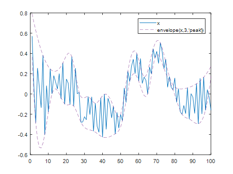
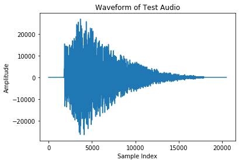
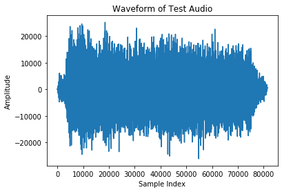
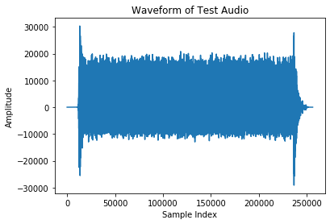
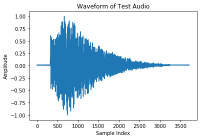
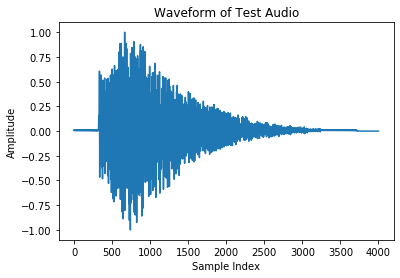
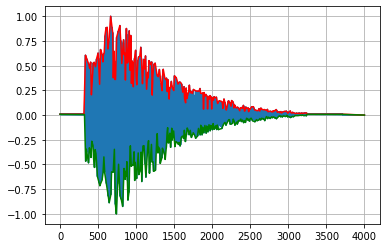
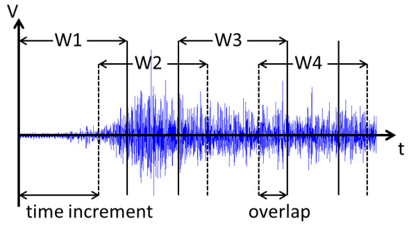
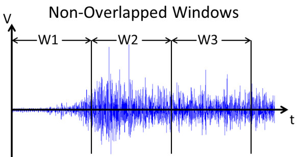
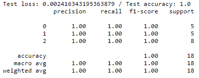

# Classification of tools sounds using Machine Learning methods
## AFEKA - Tel-Aviv Academic College Of Engineering Department: Intelligent Systems Course: Machine Learning In Speech Processing Technologies

**Course project:** Implementation of a model that classifies sounds of tools: hammer, jackhammer, drill. 
&emsp;&emsp;The model uses 2D-CNN architecture. 
**Project Completion Date:** 2021 
**Development Tools:** Python 3.7, Anaconda / Spyder / IPython. 
**Libraries:** NumPy, SciPy, Pandas, Keras / TensorFlow. 
**Data:** WAV files containing sounds of tools [1], [2]. 

---

## Abstract

In this project is presented a method of sounds classification based on envelope shape descriptor recognition.
This approach could be useful for such classification tasks as music genre, speech/music,
musical instruments classification and others [4]. I applied it for tools sounds classification.

## Introduction

The goal of this project is to develop a model that classifies sounds of tools: hammer, jackhammer, drill etc.
The idea of this project comes from my work on a perimeter security system (a smart security fence),
where sensor signals had to be classified in real time on a regular PC. This project applies a similar approach
to classifying sounds of tools. The classification has to run in real time on a standard PC without a GPU,
so the signal processing is kept simple.

## Proposed method

Envelope models are common in speech and audio processing [4, 5, 6, 7].
An envelope is defined as a continuous, usually smooth shape describing a characteristic of the signal.

 
*Figure 1. A signal with two-sided envelope*

Example of using: phonocardiogram – recording sounds of heart and processing them [8, 9].

The envelope can be either one-sided or two-sided. Also, it can be built in time domain, frequency domain
or combined time-frequency domain. The representation used in this project is two-sided and is built
in time domain, as a simple and interpretable representation of the signal shape.

The received envelopes can be classified by machine learning methods. Since this is a pattern recognition task,
I use a convolutional neural network, well-proven in image classification: the two-sided envelope
can be considered as an image.

## Tools

The tools that are used in the project: hammer, jackhammer, drill.

| Hammer | Jackhammer | Drill |
|:---:|:---:|:---:|
|  |  |  |

*Figure 2. Waveforms of the tools*

## Method

### Data preparation

1. **Changing sampling rate:** resample the original audio to 8000 Hz. 
   The audio data can be sampled in many rates, for example: 8 kHz, 44.1 kHz, 48 kHz, 96 kHz etc.
   All the audio data is resampled to the same rate of 8 kHz. This rate reduces the audio data size,
   but it still can be classified.

   | Original data: 48 kHz | Resampled data: 8 kHz |
   |:---:|:---:|
   |  |  |

   *Figure 3. Original and resampled waveforms*

2. **Normalization:** normalize the data to range [-1, 1]. 
   Audio data can have different amplitudes. In order to train or to classify it we need to unify it.

    
   *Figure 4. Normalized waveform*

3. **Fixing number of samples:** adjust number of samples to the window size (4000 samples). 
   If the current number of samples is greater, they are cut. If it is less than the window size,
   zeros are added (padding).

    
   *Figure 5. Waveform with adjusted size*

4. **Data peaks envelopes:** calculate peaks envelope for the data from the previous stage. 
   This process can be repeated several times, i.e. envelopes are built on previously created envelopes.
   In this project the process is performed twice.

    
   *Figure 6. Waveform with peaks envelope*

### Neural network architecture

For audio data classification a convolutional neural network based on the Conv2D layer [3] is used.

**Input:** envelopes received from the data preparation stage. 
**Output:** tool class (hammer, drill or jackhammer).

### Audio files classification

As a rule, an audio file is longer than the window size (4000 samples). So, the file is divided into chunks
and each chunk is processed. This process is called windowing: a window of constant size (4000 samples)
is moved across the audio data with a constant step (half of the window size – 2000 samples).

| Overlapped windowing | Non-overlapped windowing |
|:---:|:---:|
|  |  |

*Figure 7. Windowing*

**Algorithm of audio data classification:**

1. Find the maximal absolute value of the raw data in the audio file. From this value calculate the minimal value
   for a data chunk to be classified (25% of the maximal). If the maximal value of a data chunk is less than
   this value, the chunk is considered as weak signal and is ignored.
2. Allocate an array of results, one cell per class, initialized with zeros. Each time a chunk is classified,
   the relevant cell is incremented. Thus, we know how many times each class was recognized.
3. Set the window at the beginning of the audio data.
4. Check if the maximal chunk value is larger than the minimal value calculated at step 1. If not, go to step 7.
5. Preprocess the data under the window (see *Data preparation*).
6. Classify the preprocessed data. Update the results array according to the recognized class.
7. Move the window to the next position. If the end of the data is reached, go to step 8. Otherwise, go to step 4.
8. Scan the results array and find the maximal value. The class matching its index is selected as recognized.

## Implementation

**Project files:** 
* *settings.py* – global settings of the project: variables and constants. 
* *wav_files_processing.py* – WAV files preparation: dividing audio file into several files, extracting sequences 
&emsp;&emsp;from the original file and writing them to new files, resampling. 
* *samples_processing.py* – processing samples loaded from audio files: resampling, padding, normalization, 
&emsp;&emsp;peaks envelopes creation, reading/writing samples from/to audio files. 
* *peaks_envelope.py* – peaks envelopes creation. 
* *train.py* – creation/training/testing of the model. 
* *classification.py* – classification of audio files. 
* *main.py* – main module of the project. 
* *Training Results.html* – results of the model training/testing. The model training was divided into several trainings. 
&emsp;&emsp;The results presented in this file are the results of the last training. 
* *Test Classification Results.html* – results of the test audio files classification. 

**Data:** 
The audio files are not included in the repository: they were collected from public sound libraries 
(Zvukogram, wav-mp3-ogg.net, Freesound) and are subject to their own licenses. 
The code expects the following layout next to the code files: 
* *Data/Drill*, *Data/Hammer*, *Data/Jackhammer* – training/validation audio files, one directory per class 
&emsp;&emsp;(the original dataset had 32, 23 and 35 files respectively). 
* *Test* – audio files for classification (the original test set had 5 files). 

## Results

### Training

The training was performed several times on the data from the *Data* directory.
The final results are stored in the file *Training Results.html*.

 
*Figure 8. Final training/validation results*

### Testing

5 audio files were tested. 4 of 5 files were recognized correctly:
the drill and the jackhammer files are recognized with high confidence,
while the hammer file is wrongly classified as a jackhammer.

| File | Real Type | Hammer | Jackhammer | Drill | Result |
|---|---|---:|---:|---:|:---:|
| drill_1.wav | Drill | 2.11 % | 2.11 % | **95.79 %** | ✅ |
| drill_2.wav | Drill | 0.0 % | 5.17 % | **94.83 %** | ✅ |
| hammer.wav | Hammer | 22.73 % | **77.27 %** | 0.0 % | ❌ |
| jackhammer_1.wav | Jackhammer | 5.77 % | **88.46 %** | 5.77 % | ✅ |
| jackhammer_2.wav | Jackhammer | 5.13 % | **74.36 %** | 20.51 % | ✅ |

*Table 1. Test results: share of the file chunks classified as each class*

See the file *Test Classification Results.html* for details.

*Update (2026):* the first version of the classification code had a bug: the windows were taken from the original
(44.1 kHz) signal instead of the resampled (8 kHz) one, so the model received input that differed from the training data.
After the fix the test files were classified again with the same trained model; the table above shows the new results.
With the buggy code all 5 files were recognized correctly, but the hammer file only by a small margin (52 %).

**Prediction errors** occur mostly in the chunks that contain:
* weak signal;
* noise between hammer hits or other tools working;
* start/end of hammer hitting or other tools working;
* hammer and jackhammer sounds: a jackhammer produces a series of fast impacts, similar to hammer hits,
  and the hammer training set is the smallest one (23 files), so the model often confuses them;
* drill and jackhammer sounds, which are similar – sometimes the model is confused between them.

**Possible improvements and additions:**
* Extending the audio dataset, both training and testing, first of all the hammer class.
* Adding digital noise filters to reduce noise.
* Adding spectral envelopes classification instead of/combined with time domain classification.
  It may improve accuracy.
* Adding a new tool for recognition: add a new directory with relevant audio files to the directory *Data*,
  add the name of the new class to the variable `CLASSES` in *settings.py* (the directory name must be
  the same as the class name) and train the model again.

## Conclusion

The drill and the jackhammer are recognized reliably, but the model does not distinguish the hammer from the jackhammer well.
The results are based on a small dataset. In order to get more reliable results, the size of the dataset must be increased,
first of all for the hammer class. Anyway, the proposed method may be used for tools sounds classification.

## References

1. Sounds database – Zvukogram: https://zvukogram.com/
2. Sounds database: https://wav-mp3-ogg.net/
3. Conv2D layer: https://keras.io/api/layers/convolution_layers/convolution2d/
4. Lukasik, Ewa, Cong Yang, and Lukasz Kurzawski. "Temporal envelope for audio classification."
   Audio Engineering Society Convention 140. Audio Engineering Society, 2016.
5. Schwarz, Diemo. "Spectral envelopes in sound analysis and synthesis."
   Diss. Universität Stuttgart, Fakultät Informatik, 1998.
6. Jähnel, Tobias, Tom Bäckström, and Benjamin Schubert. "Envelope modeling for speech and audio processing
   using distribution quantization." 2015 23rd European Signal Processing Conference (EUSIPCO). IEEE, 2015.
7. Altaf, M. Umair Bin, and Biing-Hwang Juang. "Audio signal classification with temporal envelopes."
   2011 IEEE International Conference on Acoustics, Speech and Signal Processing (ICASSP). IEEE, 2011.
8. Liang, H., Sakari Lukkarinen, and Iiro Hartimo. "Heart sound segmentation algorithm based on heart sound
   envelogram." Computers in Cardiology 1997. IEEE, 1997.
9. Thalmayer, Angelika, et al. "A robust and real-time capable envelope-based algorithm for heart sound
   classification: Validation under different physiological conditions." Sensors 20.4 (2020): 972.
